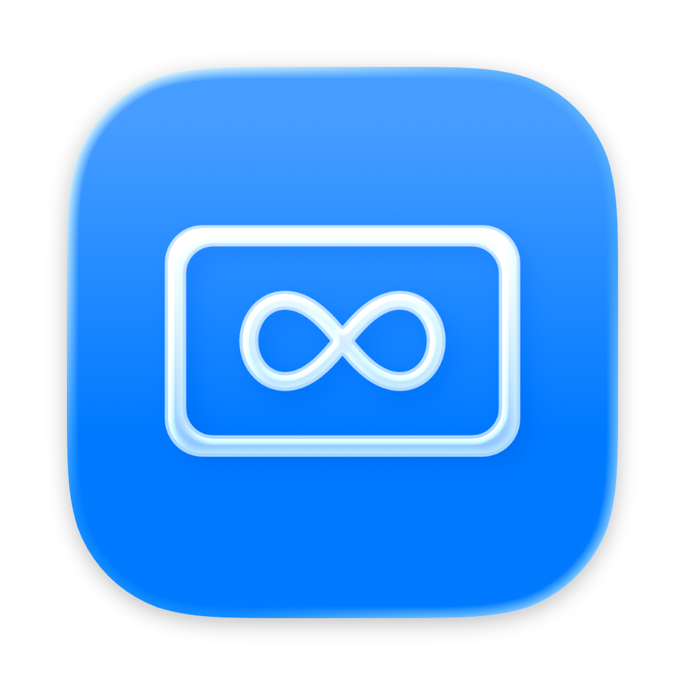
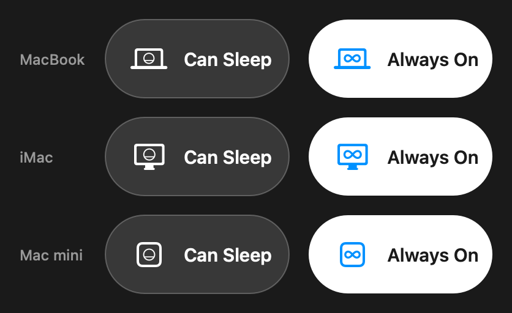

<p align="center">
  
</p>

<h1 align="center">No Dim</h1>

<p align="center">
  Keep your Mac's screen on, switched from Control Center.<br>
  <b><a href="https://github.com/myles-dean/NoDim/releases/latest/download/NoDim.dmg">Download No Dim</a></b> · macOS 26 or later · Free and open source
</p>

<p align="center">
  
  
  
  <a href="https://github.com/myles-dean/NoDim/releases/latest"></a>
</p>

<p align="center">
  <a href="https://ko-fi.com/mylesdean_"></a>
</p>

<p align="center">
  
</p>

No Dim keeps your screen from dimming or sleeping for as long as you want. There's no Dock icon and,
unless you want one, no menu bar icon: it's a tile in Control Center that reads **Always On** or
**Can Sleep**, drawn with the Mac you're using (a MacBook, an iMac, or a Mac mini, Mac Studio or Mac Pro).

## Features

- **A Control Center tile.** One click switches it on or off. When it's on, the tile turns white
  with a blue glyph, like Apple's own controls.
- **Fits your Mac.** The tile and app icon show a MacBook, an iMac or a Mac mini, whichever you have.
- **Stays out of the way.** No Dock icon. Add a menu bar icon if you like: click it for settings,
  right-click to switch No Dim on or off.
- **Power rules.** Turn on when the charger connects, turn off when it disconnects, turn off when
  the battery drops below 20%.
- **Allow display sleep.** Keep the Mac awake for downloads or renders while letting the screen
  turn off.
- **Shortcuts and links.** A **Keep Screen On** action for Shortcuts, plus `nodim://on`,
  `nodim://off`, `nodim://toggle` and `nodim://settings`.

## Install

1. [Download NoDim.dmg](https://github.com/myles-dean/NoDim/releases/latest/download/NoDim.dmg), open
   it and drag **No Dim** to **Applications**.
2. Open No Dim. A short welcome walks you through it and lets you pick your settings.
3. Add the tile: open **Control Center**, click **Edit Controls**, find **No Dim** in the list and
   drag it in. Right-click the tile and choose **Size → Medium** to see Always On or Can Sleep.

macOS doesn't let apps add tiles to Control Center themselves, so step 3 is always yours.

Or install it with [Homebrew](https://brew.sh):

```bash
brew tap myles-dean/tap
brew trust myles-dean/tap
brew install --cask no-dim
```

## Settings

Open No Dim again any time (Spotlight, Launchpad or Finder), or click its menu bar icon, and its
settings appear in a panel like Control Center's own menus.

| Setting | What it does |
| --- | --- |
| Launch at login | Starts No Dim in the background when you log in |
| Turn on at launch | Switches it on whenever No Dim starts |
| Allow display sleep | Keeps the Mac awake but lets the screen turn off |
| Allow notifications | Tells you when No Dim switches itself on or off |
| Show in menu bar | Adds a menu bar icon (off by default) |
| Turn on when charger connects | |
| Turn off when charger disconnects | |
| Turn off below 20% battery | Switches off when the battery drops under 20% |

Quitting No Dim switches it off.

## FAQ

**Why can't the tile open a menu like Wi-Fi or Focus?**
That expanding menu is only available to Apple's own tiles. An app's tile can be a switch or a
button, so No Dim's settings live in its own panel instead.

**Why did the app icon change after I opened it?**
One download serves every Mac, so No Dim ships with a neutral icon (a screen with ∞). On first launch
it gives itself the icon for your Mac. This uses the same custom-icon feature as Finder's
Get Info → paste icon, and it only happens when No Dim is in your Applications folder.

**Does it keep my Mac awake with the lid closed?**
No. Like other keep-awake apps, it prevents sleep from inactivity. Closing a laptop's lid still puts
it to sleep unless an external display is connected.

## Building from source

You need Xcode 26 or later and [XcodeGen](https://github.com/yonaskolb/XcodeGen)
(`brew install xcodegen`). Set your own team in `project.yml` (`DEVELOPMENT_TEAM`), then:

```bash
./build.sh install   # build, install to /Applications and launch
./build.sh release   # Developer ID build packaged as build/NoDim.dmg
```

With `NOTARY_PROFILE=<notarytool keychain profile>`, the release build is also notarized and stapled.

### How it works

- **Keeping the screen on:** the app holds an IOKit power assertion, `PreventUserIdleDisplaySleep`
  (or `PreventUserIdleSystemSleep` when display sleep is allowed). Check it with `pmset -g assertions`.
- **The tile:** a WidgetKit control in a sandboxed extension, which can't hold the assertion itself.
  Its intent writes the request to the shared app-group defaults, posts the Darwin notification
  `com.mylesdean.NoDim.request`, starts the app if needed and waits for it to confirm. The app writes
  back its state and reloads the control.
- **Glyphs:** custom SF Symbols drawn by `Tools/make-symbol.swift`, matched to Apple's
  `laptopcomputer`, `display` and `app` symbols at every weight and scale. They have no layer
  annotations, because Control Center draws control glyphs in hierarchical/palette mode, where
  annotated paths without layer styles draw nothing.
- **App icons:** `App/AppIcon.icon` is the neutral icon. The build has macOS draw the three Mac icons
  (`App/Icons`) in its current icon shape (`Tools/render-app-icon.swift`), and the app applies the
  matching one after install.

## License

[MIT](LICENSE)
